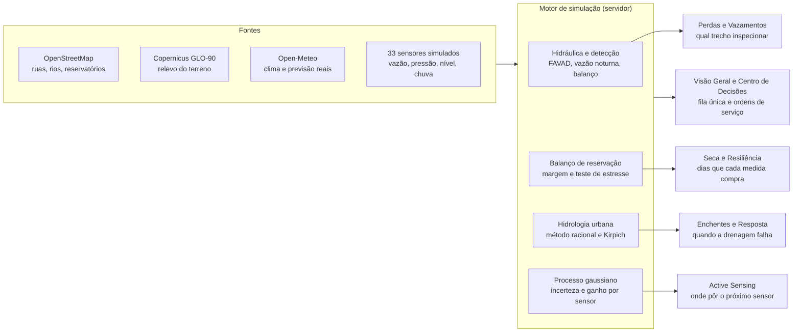

# Guia do AquaGraph

Atualizado em 17/10/2026. Histórico das mudanças: [Registro de mudanças](registro-de-mudancas.md).

O AquaGraph é um painel de operação de água urbana para Ribeirão Preto (SP), em seis abas mais um Modo Demo. O mapa, o relevo e o clima são reais; os sensores, a hidráulica e as recomendações são simulados por modelos determinísticos que variam com o relógio.

## Real × simulado

Tudo o que é geografia ou clima vem de fontes públicas reais; tudo o que dependeria de equipamento instalado na rede é simulado. Cada número na tela traz um selo de origem (CLIMA REAL, PREVISÃO REAL, SIMULADO, PROJEÇÃO, HIDROLOGIA) para deixar isso explícito.

| Dado                                                 | Origem                                                  | Real ou simulado               | Atualização                                                |
| ---------------------------------------------------- | ------------------------------------------------------- | ------------------------------ | ---------------------------------------------------------- |
| Ruas, bairros, quadras, rótulos do mapa              | OpenStreetMap, servido em vetor pelo OpenFreeMap        | Real                           | Ao abrir o mapa                                            |
| Reservatórios (15) e poços (2)                       | OpenStreetMap (Overpass)                                | Real (posição); nível simulado | Geodados gerados no build                                  |
| Hospitais (18), escolas (18), terminais (4)          | OpenStreetMap (Overpass)                                | Real                           | Geodados gerados no build                                  |
| Córregos, rios e galerias                            | OpenStreetMap (Overpass)                                | Real                           | Geodados gerados no build                                  |
| Relevo (altitude)                                    | Copernicus GLO-90 via API de elevação do Open-Meteo     | Real                           | Geodados gerados no build                                  |
| Clima atual, previsão de 48 h e histórico de 92 dias | Open-Meteo                                              | Real                           | Cache de 15 min; sem internet usa a climatologia da cidade |
| Setores de abastecimento (9)                         | Recortados a partir de pontos fixos sobre o mapa real   | Simulado                       | Fixo                                                       |
| Rede de água (1.172 km) e adutoras (37,6 km)         | Traçada sob as ruas reais do OSM                        | Simulado                       | Fixo                                                       |
| Leituras dos 33 sensores                             | Modelos hidráulico, de reservação e hidrológico         | Simulado                       | A cada minuto, em função do relógio                        |
| Vazamentos, poços parados, anomalia de consumo       | Roteiro de eventos do simulador                         | Simulado                       | Determinístico (o mesmo para todos)                        |
| População (534.740) e ligações (170.536)             | Estimativa do modelo por setor                          | Simulado                       | Fixo                                                       |
| Ordens de serviço                                    | Criadas pelo usuário; guardadas num cookie do navegador | Simulado                       | Ao clicar em executar                                      |

A simulação é determinística: dois usuários que abrem o painel no mesmo minuto veem os mesmos números, e recarregar a página não muda o cenário.

## Catálogo de sensores

A rede simulada tem 33 sensores de cinco tipos. Cada um gera uma leitura por intervalo, com ruído de medição realista, e aparece no mapa, nos cartões “Dados coletados” e no inventário do Active Sensing.

| Tipo                  | Ids                          | O que coleta                                                                   | Para que serve                                                              | Frequência | Onde aparece               |
| --------------------- | ---------------------------- | ------------------------------------------------------------------------------ | --------------------------------------------------------------------------- | ---------- | -------------------------- |
| Macromedidor de vazão | VZ-01 a VZ-09 (um por setor) | Litros por segundo (L/s) que entram no setor pela adutora                      | Balanço hídrico e vazão mínima noturna: a base da detecção de vazamentos    | 5 min      | Perdas (setor selecionado) |
| Sensor de pressão     | PS-01 a PS-12                | Pressão da rede em mca, no ponto mais alto do setor e em pontos intermediários | Queda fora do esperado aponta vazamento e ajuda a localizar o trecho        | 5 min      | Perdas                     |
| Nível de reservatório | NV-01 a NV-06                | Altura da água no reservatório, em % da capacidade                             | Mostra se a produção acompanha o consumo: o termômetro da seca              | 1 min      | Seca                       |
| Pluviômetro           | PL-01 a PL-03                | Intensidade da chuva no local, em mm/h                                         | Confirma a previsão e alimenta o modelo de escoamento                       | 1 min      | Enchentes                  |
| Régua de córrego      | RL-01 a RL-03                | Altura da lâmina d'água no córrego, em metros                                  | Antecipa o transbordamento comparando com as cotas de alerta e de inundação | 2 min      | Enchentes                  |

Onde está cada um:

- **Vazão:** VZ-01 Ipiranga (12-A), VZ-02 Jardim Iara (05-E), VZ-03 Vila Tibério (33-G), VZ-04 Centro (08-C), VZ-05 Jardim Paulista (14-B), VZ-06 Lagoinha (41-H), VZ-07 Jardim Califórnia (29-F), VZ-08 Jardim Irajá (21-D), VZ-09 Ribeirânia (17-C).
- **Pressão:** PS-01 em 12-A, PS-02 em 05-E, PS-03 em 33-G, PS-04 e PS-05 em 08-C, PS-06, PS-07 e PS-08 em 14-B (o setor do vazamento principal), PS-09 em 41-H, PS-10 em 29-F, PS-11 em 21-D, PS-12 em 17-C.
- **Nível:** NV-01 no R-04 Jardim Jóquei Clube, NV-02 no R-07 Vila Virgínia (fonte do Sistema Norte), NV-03 no R-09 (fonte do Sistema Central), NV-04 no R-06 Jardim Paulista, NV-05 no R-15 Jardim Canadá (fonte do Sistema Sul), NV-06 no R-12 Ribeirânia.
- **Chuva:** PL-01 na E.E. Hely Lopes Meirelles (Sistema Norte), PL-02 no Colégio Anchieta (Central), PL-03 no Colégio Itamarati (Sul). As escolas são reais; o equipamento é simulado.
- **Córrego:** RL-01 no Córrego do Tanquinho (vigia o ponto AL-01, Via Norte), RL-02 no Córrego do Retiro Saudoso (AL-02, Av. Doutor Francisco Junqueira), RL-03 no Ribeirão Preto (AL-03, R. Guatapará).

Passar o mouse sobre um sensor no mapa ou sobre o ícone ⓘ de um cartão mostra essa mesma explicação: o texto vem de uma fonte única no código (`src/lib/glossary.ts`).

## Como os dados fluem



As fontes reais e as leituras simuladas entram no mesmo motor, no servidor. Cada modelo alimenta a sua aba, e a Visão Geral e o Centro de Decisões juntam os quatro.

## Cabeçalho e navegação

O cabeçalho é o mesmo em todas as abas e resume o estado da cidade em uma linha. O menu lateral leva às seis abas, agrupadas em Operação (Perdas, Seca, Enchentes) e Inteligência (Active Sensing, Centro de Decisões).

| Elemento               | O que mostra                                                                                                             | De onde vem                                        |
| ---------------------- | ------------------------------------------------------------------------------------------------------------------------ | -------------------------------------------------- |
| Chip de estado         | “N alertas críticos” ou “Operação normal”; no hover, quantos sensores estão comunicando e quantos riscos são monitorados | Simulação ao vivo                                  |
| Chip “Simulação ativa” | Substitui o chip de estado quando há tempestade simulada ou sensores novos instalados; um clique volta à situação real   | Cenário da sessão                                  |
| Iniciar Demo           | Abre o tour guiado de cinco etapas                                                                                       | Modo Demo                                          |
| Local e relógio        | Ribeirão Preto — SP, data e hora reais de Brasília                                                                       | Relógio do navegador                               |
| Clima                  | Temperatura e condição atuais; no hover, a umidade                                                                       | Open-Meteo (real) ou climatologia, se a API falhar |
| Sino                   | Alertas altos e críticos do momento, com horário                                                                         | Simulação ao vivo                                  |
| Rodapé do menu         | Fontes: Mapa OpenStreetMap, Clima Open-Meteo, Sensores simulados                                                         | Fixo                                               |

O cenário escolhido (tempestade simulada, sensores instalados) fica salvo na aba do navegador e vale para todas as páginas até ser reiniciado.

## Aba 1 — Visão Geral

A Visão Geral responde “o que exige atenção agora?” e encaminha para a aba certa. Ela não repete as análises: mostra o resumo de cada módulo e um clique leva ao detalhe.

De cima para baixo:

1. **Barra de status:** hora da última atualização e o tamanho da área monitorada (1.172 km de rede, 170.536 ligações, 9 setores, 535 mil habitantes).
2. **Faixa da história:** uma frase sobre o momento (por exemplo, “2 situações exigem atenção agora”) e os dois alertas mais graves.
3. **Esteira do dado à ação:** cinco etapas com o número de cada uma, e no hover a explicação.
   - Dados coletados: 33 sensores e as leituras da última hora (cerca de 880).
   - Inteligência: os 4 modelos (perdas, seca, enchentes, sensing).
   - Riscos detectados: quantos riscos estão ativos e quantos são críticos.
   - Recomendações: ações priorizadas por impacto × confiança.
   - Ação em campo: ordens de serviço abertas e em execução.
4. **Mapa operacional:** os 9 setores coloridos pela situação (normal, atenção, alto, crítico), a rede, os córregos, os reservatórios e os 33 sensores. Uma mancha de calor marca setores com probabilidade de vazamento acima de 35%. Os marcadores de alerta abrem o módulo correspondente; clicar num setor abre Perdas.
5. **Situação por desafio:** um cartão por módulo com a métrica principal. Exemplo de leitura real do painel: Perdas “Setor 14-B · 82% prob. de vazamento”; Seca “Sistema Sul · reservação em 37%, 24 dias sob estresse”; Enchentes “1 mm previstos em 24 h”; Active Sensing “cobertura de 68%, +4,8 p.p. com S-27”.
6. **Próximas decisões:** as quatro ações de maior prioridade do Centro de Decisões, com prazo e impacto (por exemplo, “Inspecionar trecho 14B-748 — Rua Joaquim Pinto Ferraz”, crítica, próximas 4 h).
7. **Linha do tempo de hoje:** eventos em ordem, do dado à ação: quando o vazamento do 14-B passou de 35%, 60% e 80%, quando a previsão e o mapa de incerteza foram recalculados, e o andamento das ordens de serviço.

Dados usados: todos os sensores (pelo mapa), os resultados dos quatro modelos e o clima real. Nenhum número desta aba é calculado só para ela; todos vêm do mesmo retrato ao vivo (`/api/live`).

## Aba 2 — Perdas e Vazamentos

Perdas mostra onde a rede está perdendo água, por que o modelo acredita nisso e qual trecho a equipe deve inspecionar primeiro. O caso principal é um vazamento não visível no setor 14-B (Jardim Paulista), que começa às 03:10 da madrugada anterior e cresce até 11,5 L/s.

**Topo da página**

| Indicador             | Exemplo    | O que significa                                                                   | Fonte                                   |
| --------------------- | ---------- | --------------------------------------------------------------------------------- | --------------------------------------- |
| Perda física estimada | 32,1%      | Água que entrou na rede e não chegou ao consumidor, pelo balanço das últimas 24 h | Macromedidores VZ × consumo micromedido |
| Volume perdido agora  | 2.281 m³/h | Vazamentos de fundo mais eventos ativos, neste instante                           | Modelo hidráulico                       |
| Setores em alerta     | 3          | Setores com probabilidade de vazamento ≥ 35%                                      | Modelo de detecção                      |
| Tempo até a detecção  | 26 h       | Do início do vazamento do 14-B ao alerta crítico                                  | Modelo de detecção                      |

Abaixo vêm o mapa de probabilidade por setor (com mancha de calor e a rede secundária visível no zoom) e o ranking “Setores por probabilidade”. Clicar num setor, no mapa ou na lista, troca o setor analisado nas três seções seguintes.

**01 · Dados coletados.** Os sensores do setor selecionado: o macromedidor de vazão (VZ) e os sensores de pressão (PS); no 14-B são VZ-05, PS-06, PS-07 e PS-08. Cada cartão traz o valor atual, o esperado pelo modelo, o desvio e a tendência de 24 h. Dois gráficos completam a seção:

- **Vazão de entrada × consumo** (24 h, a cada 30 min): a distância entre as curvas é a perda.
- **Vazão mínima noturna** (últimas 14 madrugadas): um degrau de uma noite para outra é o sinal clássico de vazamento novo.

**02 · Riscos detectados.** “Por que o modelo gerou este alerta?” decompõe a probabilidade em cinco evidências, cada uma com seu peso. No 14-B:

| Evidência                        | Leitura                                           | Peso |
| -------------------------------- | ------------------------------------------------- | ---- |
| Vazão sem consumo correspondente | +8,3% de vazão nas últimas 24 h                   | 33   |
| Vazão mínima noturna             | +15,1% acima do esperado (99,8 × 86,8 L/s)        | 28   |
| Queda de pressão                 | −8,6% no PS-06                                    | 28   |
| Histórico da rede                | tubos com 35 anos em média, 4 reparos em 12 meses | 11   |
| Consumo micromedido              | normal: o aumento não é uso legítimo              | 0    |

“Trechos mais prováveis” lista os tubos que melhor explicam o padrão de queda de pressão, com rua, diâmetro, material, ano e participação: hoje 14B-748 (Rua Joaquim Pinto Ferraz, 27%), 14B-745 (Rua Orestes Morandini, 16%) e 14B-765 (11%). O vazamento simulado está no 14B-748; o 14B-745 fica a 50 m dele, e os dois se alternam no topo conforme o ruído dos sensores, como numa rede real antes da confirmação com geofone. “Como a detecção evoluiu” mostra a probabilidade hora a hora desde o início do evento; o botão **Reproduzir** anima o mapa e os números quadro a quadro.

**03 · Ação recomendada.** A ordem de serviço sugerida, com janela, equipe, perda evitável e confiança. **Gerar ordem de serviço** registra a OS no servidor (números a partir de OS-AG-2048); ela aparece no Centro de Decisões e na linha do tempo, “Aberta” nos primeiros 15 min e depois “Em execução”.

**Simular evento** (canto superior direito) tem três opções: reproduzir a detecção do 14-B; simular um vazamento novo, escolhendo o setor e a vazão (2 a 25 L/s) e vendo se e quando o modelo o detecta nas 30 h seguintes; e voltar à situação atual. Em setores com poucos sensores o vazamento simulado pode não ser confirmado, e o aviso sugere o Active Sensing.

## Aba 3 — Seca e Resiliência

Seca responde “quanto tempo o abastecimento aguenta e o que compra mais tempo?”. Ribeirão Preto é abastecida por poços no Aquífero Guarani, que reage em anos; a crise de curto prazo vem do calor (mais consumo) e de poços parados. Por isso o painel acompanha os reservatórios de três sistemas: Norte (setores 12-A, 05-E, 33-G), Central (08-C, 14-B, 41-H) e Sul (29-F, 21-D, 17-C). O Sul começa fragilizado, com 2 poços em manutenção.

**Topo da página.** A barra traz o clima real (chuva dos últimos 60 dias e máxima média da semana), as abas Norte/Central/Sul e o botão **Simular novo cenário**. Quatro indicadores:

| Indicador            | Exemplo                                              | O que significa                                                                                                 | Fonte              |
| -------------------- | ---------------------------------------------------- | --------------------------------------------------------------------------------------------------------------- | ------------------ |
| Reservação média     | 44%                                                  | Nível médio diário dos reservatórios dos 3 sistemas; abaixo de 25% os bairros altos começam a ter falta no pico | Sensores NV        |
| Dias até criticidade | > 150 dias (estresse: 21)                            | Quando o sistema mais frágil cruza 25% na tendência atual e no teste de estresse                                | Projeção do modelo |
| Margem de produção   | +2,4% (−3,7% quando a previsão do dia perde a chuva) | (produção dos poços − consumo − perdas) ÷ consumo; negativa por dias seguidos esvazia os reservatórios          | Modelo de balanço  |
| Calor e chuva        | 31 °C máx.; 189 mm em 60 dias (normal 127 mm)        | O clima que move o consumo                                                                                      | Open-Meteo (real)  |

O gráfico principal mostra a reservação do sistema escolhido: 90 dias observados e 150 projetados, com três linhas (observado, tendência com a previsão real, estresse) e a zona crítica abaixo de 25%. Ao lado, o **Teste de estresse** avalia cada medida sob um cenário adverso (onda de calor de +1,8 °C, metade da chuva prevista e mais um poço parado). Clicar numa linha desenha o cenário no gráfico. Hoje, no Sistema Sul:

| Medida                       | O que faz                                                   | Criticidade | Ganho     |
| ---------------------------- | ----------------------------------------------------------- | ----------- | --------- |
| Sem intervenção              | Nada; só o estresse                                         | 21 dias     | —         |
| Gestão de pressão            | −15% nas VRPs, plena entre 23h e 05h                        | > 150 dias  | +129 dias |
| Transferência entre sistemas | Até 1.600 m³/dia do Sistema Norte pelas adutoras existentes | > 150 dias  | +129 dias |
| Campanha de consumo          | −2% no consumo em 10 dias                                   | 27 dias     | +6 dias   |
| Plano combinado              | As três juntas                                              | > 150 dias  | +129 dias |

**01 · Dados coletados.** Os seis sensores de nível (NV-01 a NV-06), o gráfico Produção × consumo (m³/dia, 45 dias para trás e para a frente, com três curvas: produção dos poços, consumo e consumo + perdas) e o clima real de Ribeirão Preto (chuva diária em barras e máxima em linha, observadas e previstas pelo Open-Meteo até 15 dias à frente).

**02 · Riscos detectados.** Um cartão por sistema com nível, margem, poços parados, criticidade na tendência e sob estresse; clicar troca o sistema analisado. O mapa colore cada setor pela reservação do seu sistema.

**03 · Ações recomendadas.** As medidas ordenadas pelo tempo que compram no teste de estresse, as mesmas que vão para o Centro de Decisões.

**Simular novo cenário** abre o simulador operacional: redução de pressão de 0 a 20%, transferência ligada ou desligada, campanha ligada ou desligada e o clima projetado (previsão real, abaixo da média ou estiagem crítica). O resultado mostra os dias até a criticidade naquele clima e quanto cada medida contribuiu isoladamente.

## Aba 4 — Enchentes e Resposta

Enchentes responde “onde a drenagem vai falhar, e quando?”. Ela tem dois modos, escolhidos no topo: **Previsão real** (a chuva prevista pelo Open-Meteo para as próximas 24 h) e **Tempestade simulada** (74 mm em 3 h, distribuídos como as tempestades convectivas da região, com pico no primeiro quarto). O botão **Simular chuva extrema** troca para o segundo modo e anima a tempestade minuto a minuto.

O modelo acompanha cinco pontos críticos reais, vias que passam junto a córregos e foram escolhidas pelo relevo:

| Ponto | Via                            | Córrego                   | Bacia    | Tempo de concentração | Capacidade da galeria |
| ----- | ------------------------------ | ------------------------- | -------- | --------------------- | --------------------- |
| AL-01 | Via Norte                      | Córrego do Tanquinho      | 6,5 km²  | 49 min                | 52,7 m³/s             |
| AL-02 | Av. Doutor Francisco Junqueira | Córrego do Retiro Saudoso | 7,3 km²  | 58 min                | 71,1 m³/s             |
| AL-03 | R. Guatapará                   | Ribeirão Preto            | 11,2 km² | 57 min                | 109,2 m³/s            |
| AL-04 | R. Pernambuco                  | Ribeirão Preto            | 6,8 km²  | 63 min                | 59,2 m³/s             |
| AL-05 | R. Barretos                    | Córrego do Tanquinho      | 6,0 km²  | 35 min                | 63,0 m³/s             |

**Topo da página.** Quatro indicadores: chuva prevista nas próximas 3 h, risco hidrológico (baixo a crítico, pelo pico em relação à capacidade), pontos em risco (de 5) e tempo até o primeiro ponto chegar ao nível crítico. Com a previsão real de hoje: 0 mm, risco baixo, 0 de 5. Na tempestade simulada: 73 mm, risco crítico, 5 de 5, e a R. Barretos chega ao crítico em cerca de 55 min.

**Monitor hidrológico.** O mapa tem três vistas: Risco de alagamento (a mancha cresce durante a tempestade), Relevo (suscetibilidade calculada do terreno real: altura acima do córrego, distância até ele e posição na bacia) e Drenagem (córregos e galerias). Ao lado, “Pontos críticos priorizados” ordena os cinco pelo pico previsto. Durante a tempestade um alerta aparece no topo e pode ser dispensado.

**01 · Dados coletados.** A chuva (prevista ou simulada) em barras de intensidade e acumulado, os três pluviômetros (PL-01 a PL-03) e as três réguas (RL-01 a RL-03). O gráfico “Nível dos córregos” mostra cada régua contra a sua cota de alerta e de inundação (no Tanquinho, 2,65 m e 3,2 m).

**02 · Riscos detectados.** A tabela de pontos críticos traz, para cada um, a bacia real, o tempo de concentração, a capacidade da galeria, a vazão de pico prevista, o uso da galeria (pico ÷ capacidade) e até três hospitais, escolas ou terminais a menos de 1,1 km. Na tempestade: Via Norte a 134% da capacidade, R. Barretos a 130%, R. Pernambuco a 123%, Francisco Junqueira a 113% e Guatapará a 111%. Acima de 125% a lâmina d’água passa de cerca de 30 cm: nível crítico.

**03 · Ações recomendadas.** Com tempo firme, prevenção: limpeza preventiva da galeria mais exposta. Na tempestade, resposta coordenada antes do pico: desobstruir galerias, bloquear o tráfego nas vias críticas, avisar hospitais e escolas próximos sobre rota alternativa e alertar a Defesa Civil.

## Aba 5 — Active Sensing

Active Sensing responde “onde instalar o próximo sensor para enxergar mais da rede?”. Um processo gaussiano estima o estado hidráulico entre os 21 sensores de rede (9 de vazão e 12 de pressão) e diz quanto confia em cada estimativa. Com isso ele calcula, antes de instalar, quanto cada um dos 185 locais candidatos reduziria a incerteza.

**Topo da página.** O botão **Simular instalação · S-27** instala o próximo sensor do plano (até 3) e **Reverter** desfaz. A instalação simulada vale para todas as abas: a Visão Geral e o Centro de Decisões passam a contar com ela. Quatro indicadores:

| Indicador               | Hoje  | Com os 3 sensores do plano | O que significa                                                                        |
| ----------------------- | ----- | -------------------------- | -------------------------------------------------------------------------------------- |
| Cobertura informacional | 67,6% | 80,8%                      | Fração da rede, ponderada pela importância de cada trecho, com incerteza abaixo de 50% |
| Incerteza do modelo     | 40%   | 31,2%                      | Variância média do estado estimado: 0% é medido, 100% é sem informação                 |
| Sensores de rede        | 21    | 24                         | Vazão + pressão                                                                        |
| Capacidade de detecção  | 60%   | 68,8%                      | Chance média de um vazamento ser percebido pela telemetria                             |

**Mapa.** Três vistas: Cobertura atual, Incerteza e Recomendação IA (os locais do plano numerados). Ao lado, o cartão do próximo sensor mostra o ganho de cobertura, a queda de incerteza, os setores beneficiados e a posição no ranking.

**01 · Dados coletados.** O inventário completo dos 33 sensores, agrupado por tipo. Cada grupo explica o que o tipo mede e para que serve, e cada cartão mostra a leitura atual.

**02 · Pontos cegos.** “Incerteza por setor” ordena os setores do menos para o mais visível: hoje Jardim Iara (05-E, 70%) e Jardim Califórnia (29-F, 62,6%) são os mais cegos. Ao lado, “Por que este local?” mostra os fatores do ganho de informação do S-27 (Rua Coronel Américo Batista, 12-A):

| Fator                     | Peso | Leitura                                                             |
| ------------------------- | ---- | ------------------------------------------------------------------- |
| Maior ganho de informação | 100  | Entre 185 candidatos, é o que mais reduz a incerteza somada da rede |
| Alta incerteza no local   | 83   | O modelo explica só 17% do que acontece ali                         |
| Histórico de incidentes   | 80   | 4 reparos em 12 meses no setor 12-A                                 |
| Lacuna de telemetria      | 64   | O sensor mais próximo (PS-01) está a 1,6 km                         |
| Densidade de rede         | 46   | Cerca de 13,7 km de tubulação num raio de 900 m                     |
| Fronteira entre setores   | 33   | Num raio de 900 m a rede atende 1 setor                             |

**03 · Plano de expansão.** O gráfico “Cobertura × número de sensores novos” mostra os retornos decrescentes, de 67,6% com nenhum a 92,4% com oito, e a lista do plano: S-27 (12-A, +4,8 p.p.), S-28 (29-F, Avenida Oswaldo Aranha, +4,6 p.p.) e S-29 (41-H, +3,8 p.p.). Cada sensor novo rende um pouco menos que o anterior, porque parte do que ele veria já foi coberto.

## Aba 6 — Centro de Decisões

O Centro de Decisões junta numa fila única as recomendações dos quatro módulos, ordenadas por prioridade e depois pela confiança do modelo, e transforma uma recomendação em ordem de serviço com um clique.

**Topo da página.** Quatro contadores: Pendentes (geradas pelos modelos agora), Em execução (com OS aberta), Simuladas (com impacto projetado no teste de estresse da Seca) e Confiança média das recomendações abertas.

**Recomendações da inteligência operacional.** A tabela traz ação, local, impacto, confiança, prioridade e status, e a justificativa de cada uma com a etiqueta do módulo de origem. A fila de hoje, no cenário real:

| Ação                                                  | Módulo         | Impacto                | Confiança | Prioridade |
| ----------------------------------------------------- | -------------- | ---------------------- | --------- | ---------- |
| Inspecionar trecho 14B-748 — Rua Joaquim Pinto Ferraz | Perdas         | 48 m³/h                | 86%       | Crítica    |
| Gestão de pressão nas VRPs do Sistema Sul             | Seca           | > 150 dias             | 86%       | Alta       |
| Instalar sensor S-27 (pressão + vazão)                | Active Sensing | +4,8 p.p. de cobertura | 86%       | Alta       |
| Reduzir pressão no setor 14-B até o reparo            | Perdas         | −22 m³/h               | 82%       | Alta       |
| Instalar sensor S-28 (pressão + vazão)                | Active Sensing | +4,6 p.p. de cobertura | 82%       | Alta       |
| Transferência para o Sistema Sul                      | Seca           | > 150 dias             | 81%       | Alta       |
| Limpeza preventiva da Galeria 215                     | Enchentes      | Capacidade plena       | 77%       | Média      |
| Pesquisa acústica programada no setor 08-C            | Perdas         | 25 m³/h                | 75%       | Média      |
| Campanha de consumo — Sistema Sul                     | Seca           | +6 dias                | 74%       | Média      |
| Pesquisa acústica programada no setor 21-D            | Perdas         | 18 m³/h                | 56%       | Média      |

A fila muda com o cenário: na tempestade simulada entram as ações de resposta a enchente, e com sensores instalados o plano de expansão avança.

**Executar** cria uma ordem de serviço com equipe e prazo, avisa com uma notificação e muda o status da recomendação para “Em execução”. O painel **Ordens de serviço** lista as OS do dia: três já vêm no roteiro (OS-AG-2045, reparo de vazamento visível na Vila Tibério, em execução; OS-AG-2046, limpeza de bocas de lobo na Av. Doutor Francisco Junqueira, concluída; OS-AG-2047, aferição do macromedidor VZ-04 no Centro, aberta) e as novas recebem números a partir de OS-AG-2048. As OS ficam guardadas num cookie do navegador por 7 dias, então cada pessoa vê as suas.

**Como a fila é priorizada** explica os quatro critérios, nesta ordem: severidade do evento, confiança do modelo, retorno operacional (volume recuperado, dias ganhos ou risco evitado) e janela de oportunidade. Toda recomendação é estimativa de modelo e deve ser validada em campo.

## Modo Demo

O botão **Iniciar Demo** do cabeçalho conduz uma apresentação de cinco etapas. Cada etapa abre a aba certa e dispara sozinha o cenário daquela tela; um painel fixo mostra a etapa, a frase-chave e os botões Anterior, Próximo e Encerrar.

1. **Visão Geral.** “Ribeirão Preto real no mapa: sensores, modelos e decisões num único sistema hídrico.”
2. **Vazamento** (Perdas). “Hora a hora: pressão, vazão noturna e balanço revelam um vazamento não visível.” Reproduz a detecção do setor 14-B quadro a quadro.
3. **Seca.** “Teste de estresse: quanto tempo cada medida compra se o calor apertar.” Desenha o plano combinado no gráfico.
4. **Enchente.** “Tempestade de 74 mm em 3 h sobre o relevo real: onde e quando a drenagem falha.” Liga a tempestade simulada e a anima.
5. **Active Sensing.** “Onde o próximo sensor reduz mais a incerteza — e quanto ele vale.” Instala o S-27 e mostra a cobertura subir.

Ao concluir, uma tela de encerramento resume o fluxo (Dados → Inteligência → Previsão → Recomendação → Ação) com o lema “De monitoramento para decisão”. Iniciar ou encerrar a demo sempre volta ao cenário real, para que a apresentação comece e termine do mesmo ponto.

## O mapa

O mapa é a cidade real: o OpenStreetMap em vetor (OpenFreeMap), redesenhado no tema azul escuro do AquaGraph com as cores do design system. Ele usa MapLibre GL, carrega só no navegador e não precisa de chave de API. Por cima dele, cada aba liga as camadas do seu assunto.

| Camada                     | O que é                                                               | Real ou modelo           |
| -------------------------- | --------------------------------------------------------------------- | ------------------------ |
| Setores de abastecimento   | Os 9 setores, coloridos pela situação ou pela métrica da aba          | Modelo                   |
| Adutoras e rede principal  | 10 adutoras (37,6 km) e a rede das avenidas                           | Modelo, sob ruas reais   |
| Rede secundária            | A tubulação das ruas; aparece a partir do zoom 13                     | Modelo, sob ruas reais   |
| Probabilidade de vazamento | Mancha de calor sobre os setores em alerta                            | Modelo                   |
| Córregos e galerias        | Cursos d’água e drenagem                                              | Real (OSM)               |
| Reservatórios e poços      | 15 reservatórios e 2 poços                                            | Real (posição)           |
| Sensores                   | Os 33 sensores, com a leitura atual                                   | Modelo                   |
| Infraestrutura crítica     | 18 hospitais, 18 escolas e 4 terminais                                | Real (OSM)               |
| Campos de cor              | Risco de alagamento, suscetibilidade do relevo, incerteza e cobertura | Modelo sobre relevo real |
| Locais recomendados        | Os sensores do plano de expansão                                      | Modelo                   |

Como usar:

- **Passar o mouse** sobre qualquer elemento abre uma explicação do que ele é, com o valor atual e um selo de origem (dado real ou modelo).
- **Camadas:** o painel no canto liga e desliga cada camada da aba.
- **Busca:** encontra setor, sensor, reservatório, ponto crítico ou equipamento e voa até ele.
- **Controles:** aproximar, afastar e enquadrar a cidade; escala e legenda no rodapé.
- **Marcadores:** alertas e recomendações aparecem como pinos com etiqueta; clicar abre o detalhe ou o módulo.

O mapa se reenquadra quando a janela muda de tamanho, até a pessoa mover o mapa por conta própria.

## Modelos e fórmulas

Todos os modelos são funções determinísticas do relógio, do relevo real e do clima real: não há sorteio a cada requisição. O ruído dos sensores também é determinístico (derivado do id do sensor e do minuto), por isso as curvas parecem medições de verdade e se repetem para todos.

**Hidráulica (Perdas).** O consumo segue uma curva horária típica de cidade brasileira, com madrugada baixa, picos de manhã e no começo da noite e fim de semana diferente. A pressão parte da cota real do reservatório menos a cota real do terreno e cai com a perda de carga, que cresce com a vazão elevada a 1,85 (Hazen-Williams). O vazamento de fundo segue o modelo FAVAD, e cada vazamento pontual se comporta como um orifício:

```math
L_{fundo} = L_{ref}\left(\frac{P}{30}\right)^{1{,}15} \qquad Q_{vaz} = Q_0\,\sqrt{\frac{P}{30}}
```

**Detecção de vazamento.** Quatro desvios em relação ao esperado viram escores: vazão mínima noturna (peso 0,36), balanço vazão × consumo (0,30), pressão (0,26) e consumo micromedido (que reduz o escore quando o aumento é uso legítimo), mais o histórico da rede como prior. Uma logística calibrada converte o escore em probabilidade, com teto de 92%:

```math
p = 92\% \cdot \sigma\big(1{,}15\,(s - 2{,}7)\big)
```

**Localização.** Para cada tubo antigo do setor, o modelo supõe o vazamento ali e prevê a queda de pressão em cada sensor (um termo local que decai com a distância, alcance de 650 m, mais a perda de carga global). Compara com a média das últimas 24 h (uma leitura a cada 5 min) e transforma o erro em verossimilhança; a participação de cada tubo é a sua fatia do total.

**Seca.** O nível do reservatório relaxa a cada dia na direção de um equilíbrio dado pela margem de produção. O consumo sobe 1,8% por grau acima de 28 °C e cai 6% em dias com 5 mm de chuva ou mais. A produção depende dos poços disponíveis; a redução de pressão corta perdas pelo FAVAD. Nos primeiros 16 dias o clima é a previsão real; depois, o valor esperado da climatologia do mês.

```math
N_{t+1} = N_t + 0{,}06\,\big(E_t - N_t\big) \qquad E_t = 60 + 400 \cdot \frac{\text{produção} - \text{consumo} - \text{perdas}}{\text{consumo}}
```

**Enchentes.** A vazão de pico em cada ponto vem do método racional, com a bacia e o coeficiente de escoamento de cada ponto; o tempo de concentração vem da fórmula de Kirpich com o comprimento e a declividade reais do talvegue. A tempestade simulada distribui 74 mm em 3 h pela curva de Huff do 1º quartil, e acima de 125% da capacidade da galeria o ponto é crítico.

```math
Q = \frac{C \cdot i \cdot A}{3{,}6} \qquad t_c = 0{,}0195\, L^{0{,}77}\, S^{-0{,}385}
```

**Active Sensing.** Um processo gaussiano sobre 1.808 pontos da rede (células de 200 m, ponderadas pela extensão de tubulação, com a rede principal valendo 1,6 vez a secundária), com kernel gaussiano de alcance ℓ = 1.100 m e ruído de medição τ² = 0,04. Um ponto está coberto quando a variância posterior fica abaixo de 0,5. O plano escolhe, de forma gulosa, o candidato que mais reduz a variância somada da rede, depois o seguinte, e assim por diante.

```math
k(x, x') = \exp\left(-\frac{\lVert x - x' \rVert^2}{2\,\ell^2}\right)
```

## Para desenvolvedores

O AquaGraph é uma aplicação TanStack Start (React 19) com back-end no mesmo projeto: as rotas em `src/routes/api` rodam no servidor (Cloudflare Workers no deploy) e chamam o motor de simulação em `src/server/sim`. Os geodados reais são gerados uma vez e versionados, então o site não depende do Overpass em produção.

**Rodar localmente**

1. `npm install`
2. `npm run dev` e abrir http://localhost:8080
3. `npm run build` gera a versão de produção em `.output/`

**Regenerar os geodados.** `npm run geodata` baixa ruas, córregos, reservatórios e equipamentos do OpenStreetMap (Overpass, com três espelhos) e o relevo do Open-Meteo, e grava `public/geo/rp-base.json`, `public/geo/rp-secondary.json` e `src/server/geo/rp-model.json`. As respostas ficam em cache em `scripts/.geodata-cache/`, separadas pelo recorte, então rodar de novo não repete os downloads. A cidade, o recorte e os setores ficam em `scripts/geodata/config.mjs`.

**Endpoints da API**

| Rota                     | Parâmetros                                                         | Devolve                                                                                         |
| ------------------------ | ------------------------------------------------------------------ | ----------------------------------------------------------------------------------------------- |
| `GET /api/live`          | `rain` (real ou extreme), `install` (0 a 3)                        | Retrato da cidade: sensores, setores, manchetes, linha do tempo, ações e notificações           |
| `GET /api/losses`        | `sector`                                                           | KPIs de perdas, ranking de setores e o detalhe do setor (evidências, trechos, 24 h, madrugadas) |
| `GET /api/losses-replay` | `sector`, `size`                                                   | Quadros hora a hora da detecção, real ou de um vazamento hipotético                             |
| `GET /api/drought`       | `system`, `scenario` ou `pressure`, `transfer`, `campaign`, `rain` | Sistemas, séries de 240 dias, teste de estresse e simulador                                     |
| `GET /api/flood`         | `mode` (real ou extreme)                                           | Previsão ou tempestade, pontos críticos, quadros da animação, réguas e campos de risco          |
| `GET /api/sensing`       | `install` (0 a 3)                                                  | Cobertura, incerteza, plano, curva e campos do processo gaussiano                               |
| `GET /api/decisions`     | `rain`, `install`                                                  | Fila de recomendações e ordens de serviço                                                       |
| `POST /api/decisions`    | `{ id }`                                                           | Executa uma recomendação e devolve a OS criada (grava o cookie `ag_ops`)                        |
| `GET /api/weather`       | —                                                                  | O clima normalizado do Open-Meteo                                                               |

O clima fica em cache por 15 min no servidor; se o Open-Meteo falhar, o servidor continua servindo o último valor por até 6 h e, sem nenhum, usa a climatologia da cidade.

## Limitações

O AquaGraph é uma demonstração: a geografia e o clima são reais, mas a operação é inventada com plausibilidade.

- **A rede não é a do DAERP.** Setores, tubos, diâmetros, materiais e anos foram traçados sob as ruas reais para parecer uma rede de verdade; não correspondem ao cadastro da autarquia.
- **Capacidades e população são estimativas.** O OpenStreetMap dá a posição dos reservatórios, não o volume; a população por setor também é do modelo.
- **Os eventos são roteirizados.** Os vazamentos do 14-B, 08-C e 21-D, a anomalia de consumo do 33-G e os poços parados acontecem sempre, relativos ao relógio, para que a história funcione em qualquer horário.
- **Ordens de serviço ficam no navegador.** Elas vivem num cookie por 7 dias; outra pessoa, ou outro navegador, não as vê.
- **Sem internet, o clima é a climatologia.** Se o Open-Meteo não responder, o painel avisa no chip de clima e usa as médias da cidade.
- **Probabilidades são de modelo.** Os números indicam onde olhar primeiro; a confirmação é sempre em campo.
